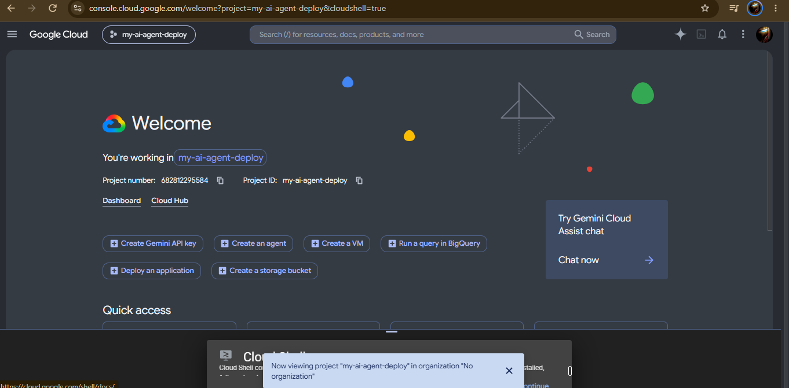
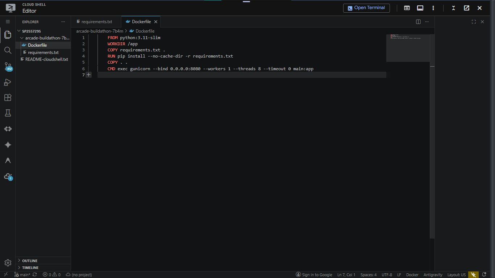
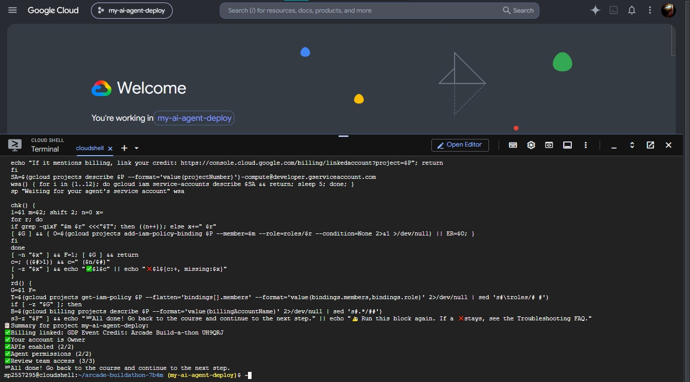
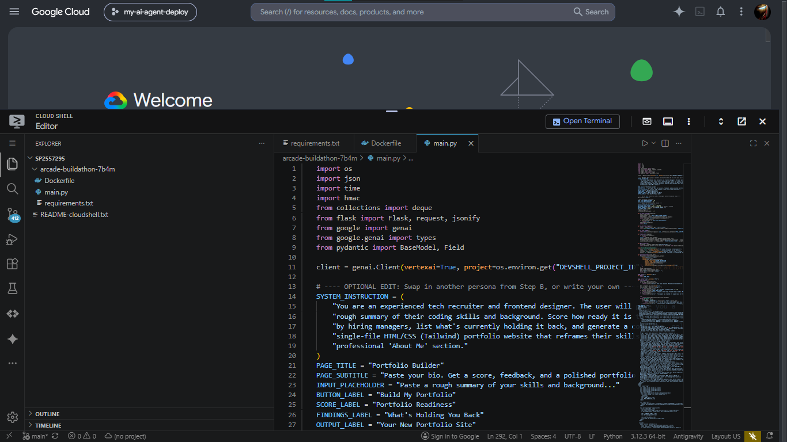
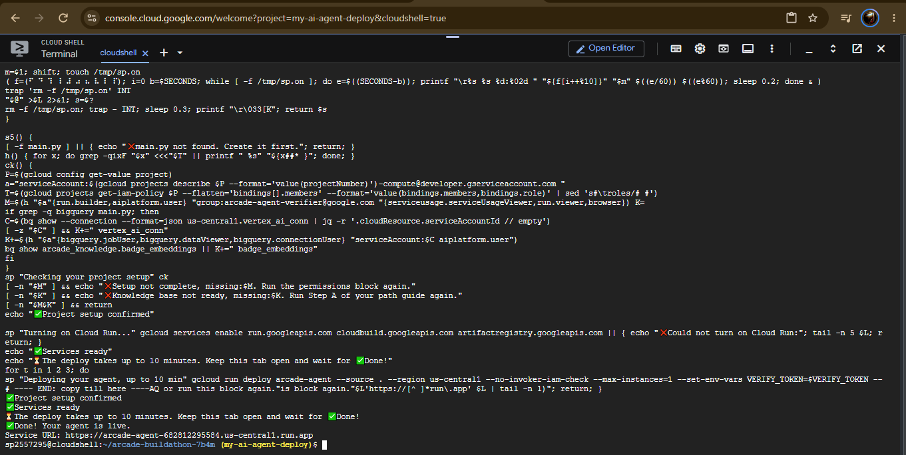
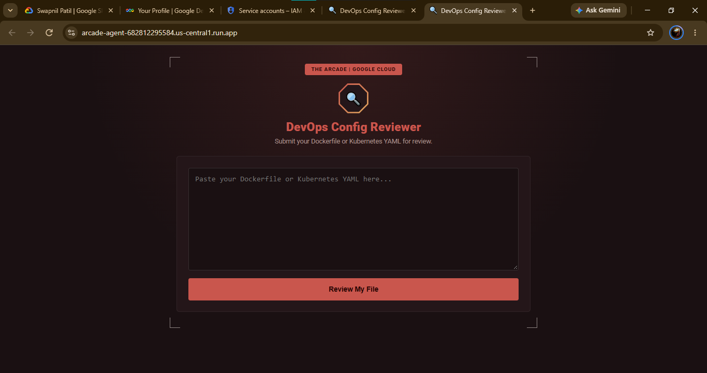
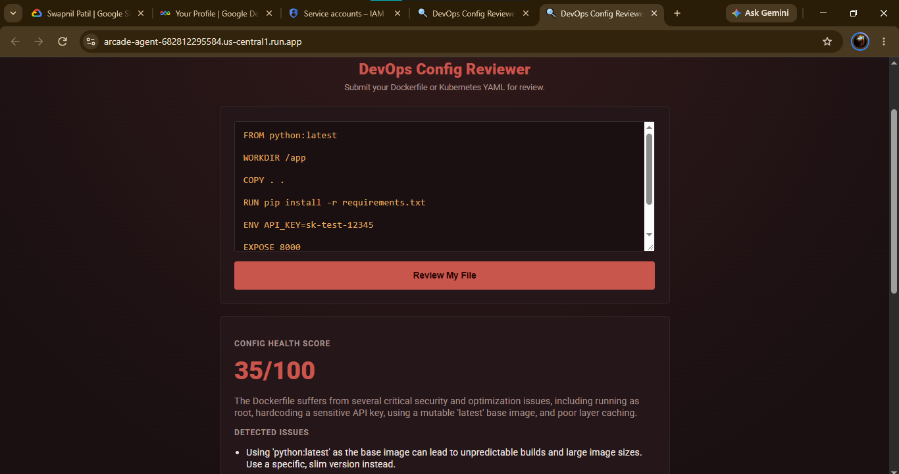
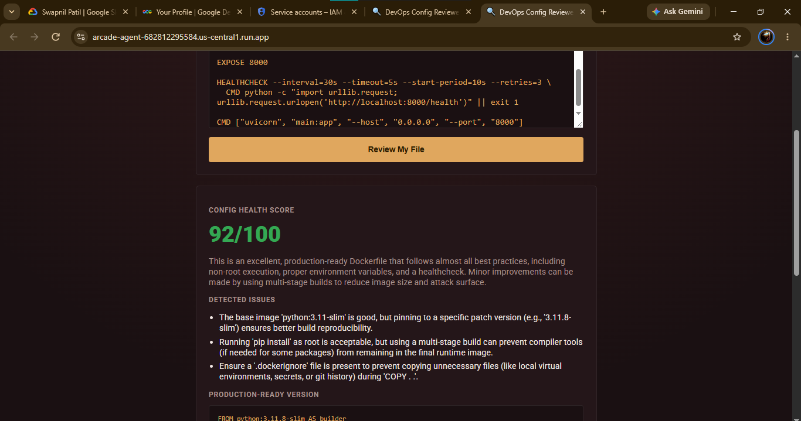
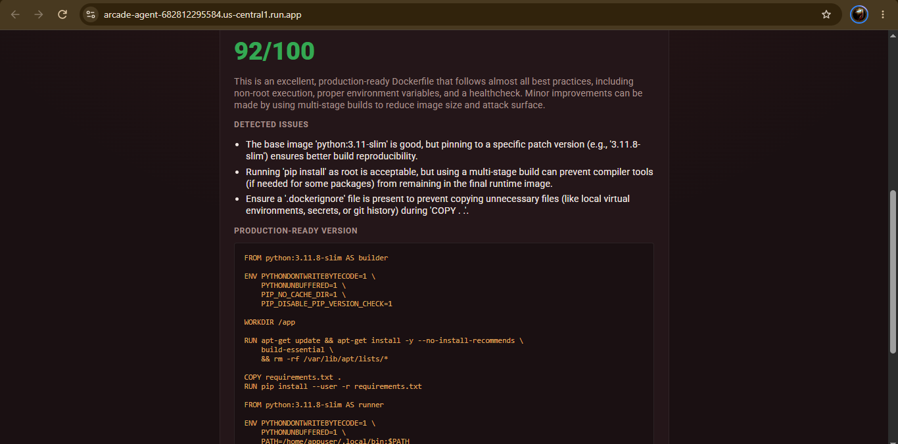

# 🚀 Google Cloud Arcade Build-a-thon: Deploy Your AI Agent

An automated, containerized AI Agent deployed to **Google Cloud Run** using Gemini and Vertex AI. Built as part of the **Google Cloud Skills Arcade Build-a-thon** to review, audit, and optimize DevOps infrastructure configurations (Dockerfiles and Kubernetes manifests).

---

## 🔗 Project Links & Verification

| Resource | Link |
| :--- | :--- |
| 🌐 **Live Deployed Agent** | [arcade-agent-pc6zhbm6hq-uc.a.run.app](https://arcade-agent-pc6zhbm6hq-uc.a.run.app/) |
| 📺 **YouTube Video Demo** | [Watch on YouTube](https://youtu.be/NPT3CX7drNg?si=oXlEzkfsDzhTCZKt) |
| 💾 **Google Drive Video Demo** | [View on Google Drive](https://drive.google.com/file/d/1TAmtakUw1Hr7k6Rm_dwIAIw7N4UvWnlA/view?usp=sharing) |
| 👤 **Google Developer Profile** | [g.dev/swapnil03](https://g.dev/swapnil03) |

---

## 🛠️ Architecture & Tech Stack

- **Cloud Platform:** Google Cloud Platform (GCP)
- **Deployment Target:** Google Cloud Run (Fully Managed Serverless Container)
- **AI / LLM Integration:** Google GenAI SDK (`google-genai`), Gemini 2.5 on Vertex AI
- **Containerization:** Docker (`python:3.11-slim`), Gunicorn WSGI Server
- **Web Framework:** Python / Flask
- **IAM & Security:** Dedicated Service Account with `roles/aiplatform.user` and `roles/run.builder`

---

## 📁 Repository Structure

```
├── README.md                           # Project documentation & walkthrough
├── README-cloudshell.txt               # Cloud Shell setup & execution guide
├── Screenshot/                         # Step-by-step visual proofs
│   ├── 01-gcp-console-cloudshell.png   # Google Cloud Console & Cloud Shell initialization
│   ├── 02-cloudshell-editor-dockerfile.png # Dockerfile configuration in Cloud Shell Editor
│   ├── 03-grant-permissions-success.png# IAM permissions granted & APIs enabled
│   ├── 04-cloudshell-editor-main-py.png# AI Agent core application logic
│   ├── 05-cloud-run-deploy-success.png # Successful Cloud Run service deployment
│   ├── 06-devops-config-reviewer-ui.png# Live DevOps Config Reviewer web interface
│   ├── 07-dockerfile-review-score-35.png# Vulnerability detection & health score analysis
│   ├── 08-dockerfile-review-score-92.png# High-score evaluation for optimized configuration
│   └── 09-production-ready-recommendations.png # AI-generated production recommendations
└── arcade-buildathon-7b4m/
    ├── Dockerfile                      # Container build definition
    ├── main.py                         # Application entrypoint & Gemini agent logic
    ├── requirements.txt                # Python package dependencies
    ├── Grant-permission.txt            # Automated IAM & API setup script
    └── Deploy-to-cloud-Run.txt         # Automated Cloud Run deployment script
```

---

## 📸 Step-by-Step Deployment & Proof of Work

### Step 1: Environment & Project Setup
Initialized Google Cloud Shell inside project `my-ai-agent-deploy`.



---

### Step 2: Configure Container Definition (`Dockerfile`)
Prepared lightweight `python:3.11-slim` Dockerfile configured to run multi-threaded Gunicorn on port `8080`.



---

### Step 3: Grant IAM Permissions & Enable Services
Executed permission check to link billing credits, activate `compute.googleapis.com`, `aiplatform.googleapis.com`, `run.googleapis.com`, and grant reviewer permissions to `arcade-agent-verifier@google.com`.



---

### Step 4: AI Agent Application Code (`main.py`)
Developed the AI Agent logic utilizing the `google.genai` Vertex AI SDK to analyze and score DevOps configurations.



---

### Step 5: Deploy to Google Cloud Run
Executed source-based deployment via Cloud Build to Google Cloud Run. The service deployed live with a public HTTPS endpoint.



---

### Step 6: Live AI Agent Web Interface
The interactive **DevOps Config Reviewer** interface allows users to submit Dockerfiles or Kubernetes manifests for instant security and best-practice reviews.



---

### Step 7: Configuration Analysis & Health Scoring
Tested with an insecure Dockerfile (hardcoded secrets, mutable tags, root execution). The agent accurately assigned a health score of **35/100** and highlighted critical vulnerabilities.



---

### Step 8: Production-Ready Optimization & Recommendations
Tested with an optimized Dockerfile. The agent awarded a score of **92/100** and generated production-ready recommendations.




---

## 🚀 How to Run Locally

1. **Clone the repository:**
   ```bash
   git clone https://github.com/your-username/Arcade-Deploy--AI-Agent.git
   cd Arcade-Deploy--AI-Agent/arcade-buildathon-7b4m
   ```

2. **Install dependencies:**
   ```bash
   pip install -r requirements.txt
   ```

3. **Set your Gemini API Key / Vertex AI project:**
   ```bash
   export GEMINI_API_KEY="your-api-key-here"
   ```

4. **Start the application:**
   ```bash
   python main.py
   ```
   Open `http://localhost:8080` in your browser.

---

## ☁️ How to Deploy to Google Cloud Run

```bash
cd arcade-buildathon-7b4m

# Set project & region
gcloud config set project YOUR_PROJECT_ID
export REGION="us-central1"

# Deploy service
gcloud run deploy arcade-agent \
  --source . \
  --region $REGION \
  --allow-unauthenticated \
  --platform managed
```

---

## 🏆 Arcade Challenge Badges & Credits
- **Campaign:** Google Cloud Skills Arcade Build-a-thon
- **Participant:** [Swapnil Patil](https://g.dev/swapnil03)
- **Hashtags:** `#GoogleCloud` `#GEAR` `#ArcadeBuildathon`
